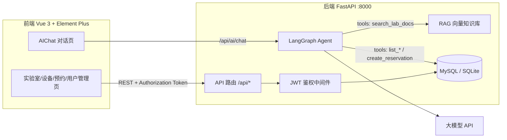

# 🧪 Lab Agent — AI 智能实验室预约系统


一个前后端分离的智能实验室预约平台。用户可以在线浏览实验室与设备、提交预约并等待管理员审批；内置的 **LangGraph Agent** 智能助手支持自然语言问答与对话式预约，结合 ChromaDB 向量知识库（RAG）回答实验室规则、安全规范、开放时间等问题。

## ✨ 核心功能

| 模块 | 说明 |
|---|---|
| 🔐 用户认证 | JWT 鉴权（PyJWT + bcrypt），注册 / 登录 / 资料修改 / 密码修改 |
| 🏫 实验室管理 | 实验室与设备的增删改查，管理员专属 |
| 📅 预约系统 | 对话式/手动预约 → 待审核 → 管理员审批 → 通过后生效；后台定时任务自动清理过期预约 |
| 🤖 AI 智能助手 | LangGraph 工具调用 Agent：查询实验室文档、列出可用实验室/设备、确认后真实落库预约、日期换算 |
| 📚 RAG 知识库 | ChromaDB + sentence-transformers 向量化实验室文档，启动时预热模型避免首请求超时 |
| 📁 文件上传 | 图片/文档/压缩包上传（最大 100MB），静态资源挂载访问 |

## 🏗️ 技术栈

**后端** — Python / FastAPI / SQLAlchemy / LangGraph / LangChain-OpenAI / ChromaDB / sentence-transformers

**前端** — Vue 3 / Vite / Element Plus / Vue Router / Axios / marked（AI 回复 Markdown 渲染）

## 📐 系统架构



## 🚀 快速开始

### 后端

```bash
cd backend
python -m venv .venv
# Windows:
.venv\Scripts\activate
# Linux / macOS:
source .venv/bin/activate

pip install -r requirements.txt
cp .env.example .env   # 填入 LLM_API_KEY / LLM_BASE_URL / LLM_MODEL 等
uvicorn app.main:app --reload
```

- 接口文档（Swagger）：http://localhost:8000/docs
- 默认使用 SQLite（开箱即用）；如需 MySQL，修改 `.env` 中 `DATABASE_URL` 即可
- 首次启动会加载 embedding 模型预热向量库（约 15s），属正常现象

### 前端

```bash
cd frontend
npm install
npm run dev
```

访问 http://localhost:5173（CORS 已配置）。

## 📡 API 概览

| 模块 | 前缀 | 主要接口 |
|---|---|---|
| 认证 | `/api/auth` | `POST /register` `POST /login` `GET /me` `PUT /update_me` `PUT /password` |
| 用户 | `/api/user` | `GET /list` `PUT /{user_id}` `DELETE /{user_id}` |
| 实验室 | `/api/lab` | `GET /list` `POST` `PUT /{lab_id}` `DELETE /{lab_id}` |
| 设备 | `/api/equipment` | `GET /list/{lab_id}` `POST` `PUT /{equipment_id}` `DELETE /{equipment_id}` |
| 预约 | `/api/reservation` | `GET /list` `POST` `PUT /{id}/cancel` `PUT /{id}/audit` |
| AI | `/api/ai` | `POST /chat`（多轮对话，Agent 工具调用） |
| 文件 | `/api/files` | `POST /upload` |

## 📁 项目结构

```
lab-agent/
├── backend/
│   ├── app/
│   │   ├── api/            # 路由层（auth / user / lab / equipment / reservation / ai / files）
│   │   ├── models/         # SQLAlchemy 数据模型
│   │   ├── schemas/        # Pydantic 请求/响应模型
│   │   ├── service/        # 业务层：Agent 编排、工具定义、向量库、预约扫描任务
│   │   ├── dependencies/   # 依赖注入（JWT 鉴权等）
│   │   ├── common/         # 统一响应与全局异常处理
│   │   ├── config.py       # pydantic-settings 配置（读取 .env）
│   │   └── main.py         # 应用入口（lifespan：向量库预热 + 过期扫描任务）
│   └── requirements.txt
└── frontend/
    └── src/
        ├── views/          # 页面：登录/注册/首页/实验室/设备/预约/AI对话/审批/个人中心
        ├── components/     # 预约弹窗等复用组件
        ├── router/         # Vue Router 路由守卫
        └── api/            # Axios 封装
```

## ⚙️ 环境变量

后端 `.env`（参考 [backend/.env.example](backend/.env.example)）：

| 变量 | 说明 |
|---|---|
| `DATABASE_URL` | 数据库连接串（SQLite / MySQL） |
| `JWT_SECRET_KEY` | JWT 签名密钥 |
| `JWT_ALGORITHM` / `JWT_EXPIRE_HOURS` | JWT 算法与有效期 |
| `LLM_API_KEY` / `LLM_BASE_URL` / `LLM_MODEL` | 大模型 API 配置（OpenAI 兼容协议） |

## 📝 设计要点

- **Agent 安全约束**：预约落库前必须向用户复述完整信息并获得确认；禁止编造数据库不存在的实验室/设备，`lab_id` / `equipment_id` 缺失时必须先查询再创建
- **对话循环上限**：`recursion_limit = 10`，防止 Agent 无限循环
- **异步任务**：预约过期扫描在 FastAPI `lifespan` 中启动、关闭时优雅取消
- **向量库预热**：模型加载移至启动阶段（`asyncio.to_thread`），避免首个请求超过前端 30s 超时
